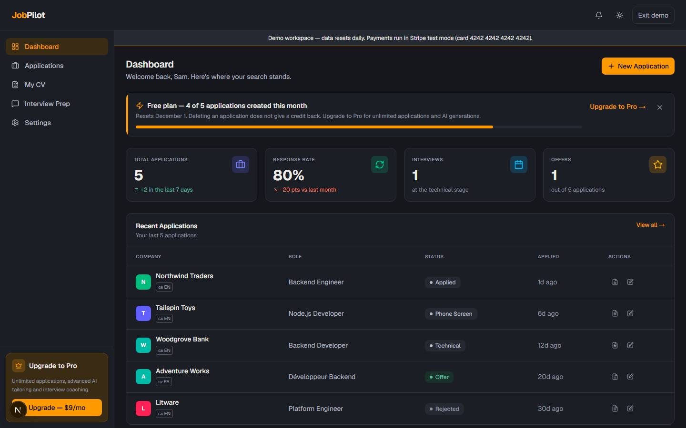
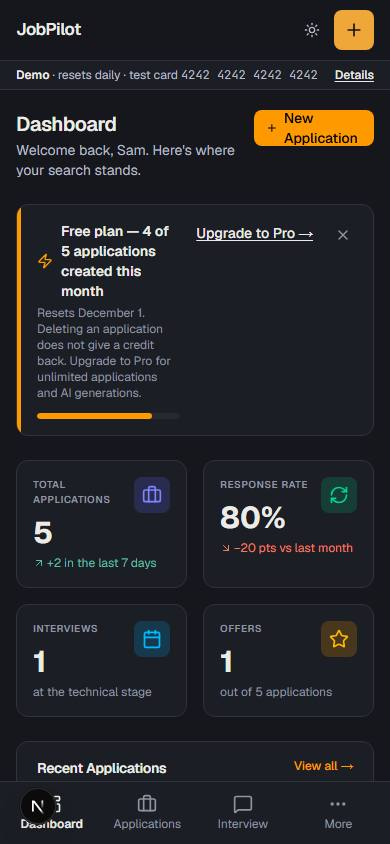
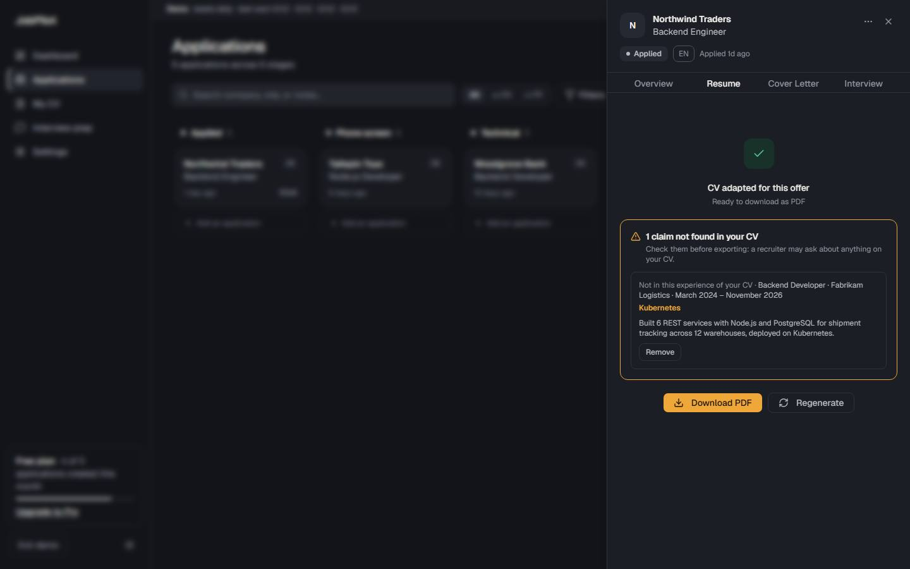
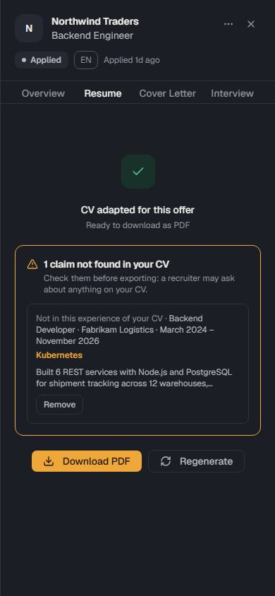
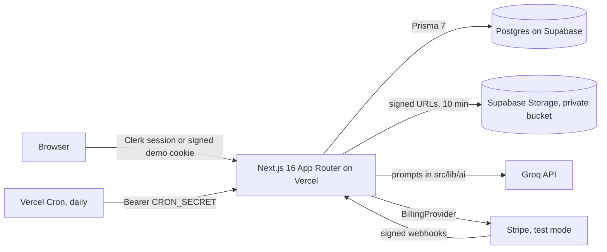

# JobPilot

[](https://github.com/Gninho-silue/jobpilot/actions/workflows/ci.yml)

JobPilot adapts your CV and writes your cover letter for each job offer, then checks every claim against your original CV.

**[Try the demo](https://jobpilot-jet.vercel.app)**: no account needed. The demo is a fictional workspace that resets every day.

| Dashboard, desktop | Dashboard, mobile |
| --- | --- |
|  |  |

| Fact-check panel, desktop | Fact-check panel, mobile |
| --- | --- |
|  |  |

## The problem

When a language model "adapts" a CV to a job offer, it tends to add what the offer asks for: a technology the candidate never used, a figure rounded up, a job title that sounds closer to the role. A candidate who sends that CV can be caught out in the first interview.

The prompts forbid inventing anything, yet in real use the model still added Redis to an internship that never used it. So a deterministic checker, in plain TypeScript with no AI involved (`src/lib/fact-check/`), compares the adapted CV with the original one, entry by entry:

- technologies, from a curated vocabulary that accepts listed rewordings ("React.js" is "React");
- figures, percentages and years;
- companies, dates and job titles.

A technology the CV lists for one job cannot move to another job. A figure that changed is reported with the original value.

When the checker finds something, JobPilot regenerates once and gives the model the list of corrections. Anything still unsupported is shown before export, with its experience and a button that removes it in one click. Exporting the PDF anyway takes an explicit confirmation.

Cover letters go through a lighter version of the same check. It catches:

- two experiences merged into one;
- statements about the candidate that the CV does not support ("I have closely followed your company");
- continuous integration turned into "continuous deployment";
- generic phrases such as "aligns perfectly".

The other features are a kanban tracker, interview questions built from the offer and the CV with feedback on answers (Pro plan, and in the demo within a daily quota), and PDF export.

## Architecture



- **Next.js 16** (App Router, React 19) with TypeScript and Tailwind CSS.
- **Clerk** for sign-in. Demo visitors get a signed cookie instead (see below).
- **Prisma 7** on **Postgres** (Supabase), with versioned migrations in `prisma/migrations/`.
- **Supabase Storage** for the uploaded CV PDF. The text is extracted once at upload with `unpdf`, and the AI routes use that text.
- **Groq** runs the model (`openai/gpt-oss-120b` by default). All prompts live in `src/lib/ai/`.
- **Stripe in test mode** sits behind a `BillingProvider` interface (`src/lib/billing/`), so another payment provider can replace it. **No real payment is possible**: use the test card 4242 4242 4242 4242.
- **PDF export** with `@react-pdf/renderer`.

## Security choices

- **Authenticated API.** Every API route goes through `getActor()` (`src/lib/actor.ts`), which accepts a Clerk session or a signed demo cookie. Resources are filtered by owner, so another user's application answers 404. Three routes have their own protection instead:
  - the billing webhook checks the provider's signature;
  - the demo purge cron requires `CRON_SECRET`;
  - starting a demo is rate-limited per IP.
- **Row Level Security** is enabled on every table of the `public` schema, and the CV bucket is private. A CI job fails if a bucket becomes public or a table loses RLS.
- **Private CVs.** The database stores a storage path, never a URL. A CV is served through a 10-minute signed URL, after an ownership check.
- **Rate limiting in Postgres.** A sliding window holds across serverless instances: 10 AI calls per minute per user.
- **Atomic free-plan quotas.** One conditional `UPDATE` checks and consumes a credit: 5 applications, 3 CV adaptations and 3 cover letters a month. Ten concurrent requests with one credit left produce exactly one success (tested).
- **Idempotent webhooks.** Each billing event id is recorded in the same transaction as the plan change, so a redelivered event changes nothing.
- **Prompt injection.** The CV and the offer reach the model only inside delimited data blocks, with a length cap. The system message holds the instructions.
- **The demo:**
  - the cookie is signed with HMAC-SHA256, HttpOnly and lasts 24 hours;
  - each visitor has an isolated workspace;
  - AI use is capped per visitor and per IP each day;
  - Stripe checkout is allowed only with a test key;
  - a daily cron purges workspaces older than 24 hours, and each run is recorded in a `CronRun` table.

## Tests and CI

| Suite | Tests | What it covers |
| --- | --- | --- |
| Unit (Vitest) | 494 | fact-checker, prompts, LLM response parsing, dashboard figures, demo cookie, components (Testing Library) |
| Integration (Vitest + Postgres) | 216 | every API route: 401 without a session, 404 on another user's data, quotas, rate limits, webhooks, demo isolation and purge |
| End-to-end (Playwright) | 16 | the full demo journey (offer, adapted CV and its fact-check, cover letter, both PDFs, feedback on an interview answer), starting, leaving and limiting the demo, the fact-check panel at 1440, 1175 and 390 px, kanban cards with long names at 1440, 1280 and 390 px, and the demo at 390 px, which fails if anything goes past the edge of the screen |

On top of those, the unit project has 10 tests that run only when the real (git-ignored) PDFs are present, so CI skips them. The tests never call Groq, Stripe or Supabase. The end-to-end tests answer with a fake language model (`E2E_FAKE_LLM=1`, which a production build refuses) and sign in with a Clerk test account.

GitHub Actions runs on every pull request and on `main`:

- lint and type check;
- unit and integration tests against a throwaway Postgres;
- the Playwright suite against a production build;
- the build;
- `npm audit`;
- on `main`, the Supabase security check.

After each production deployment, a smoke test (`npm run smoke:prod`) checks the live site:

- the home page answers;
- the public URLs point to the production address;
- a demo opens and its dashboard shows.

It then deletes that demo, and makes no AI or billing call.

## Run locally

You need Node 22, a Postgres database (Supabase works), a Clerk development instance and a Groq API key. Stripe test keys are optional unless you try the upgrade flow.

```bash
git clone https://github.com/Gninho-silue/jobpilot.git
cd jobpilot
npm ci
cp .env.example .env.local   # then fill in the values
npx prisma migrate deploy    # creates the tables in DATABASE_URL
npm run dev                  # http://localhost:3000
```

With Supabase, run `prisma migrate deploy` through the session pooler (port 5432) or the direct connection. The transaction pooler (port 6543) does not work for migrations.

In Supabase, create a **private** Storage bucket named `cvs` before uploading a CV.

To enable the demo, generate the two secrets below, put them in `.env.local` as `DEMO_COOKIE_SECRET` and `CRON_SECRET`, and use a different value for each:

```bash
node -e "console.log(require('crypto').randomBytes(32).toString('base64url'))"
```

Tests:

```bash
npm run test:unit
npm run test:integration   # starts Postgres with Testcontainers (Docker), or uses TEST_DATABASE_URL
npm run test:e2e           # Docker for Postgres, plus Clerk test keys and E2E_CLERK_PASSWORD in .env.local
```

## Project layout

```
src/app/            pages and API routes (App Router)
src/lib/ai/         every prompt and model call
src/lib/fact-check/ the deterministic checker for adapted CVs and cover letters
src/lib/demo/       demo cookie, seed data, quotas, purge
src/lib/billing/    BillingProvider interface and the Stripe implementation
prisma/             schema and migrations
test/, e2e/         integration and Playwright tests (unit tests sit next to the code)
design/             screenshots before and after the redesign, and its proposal
```
