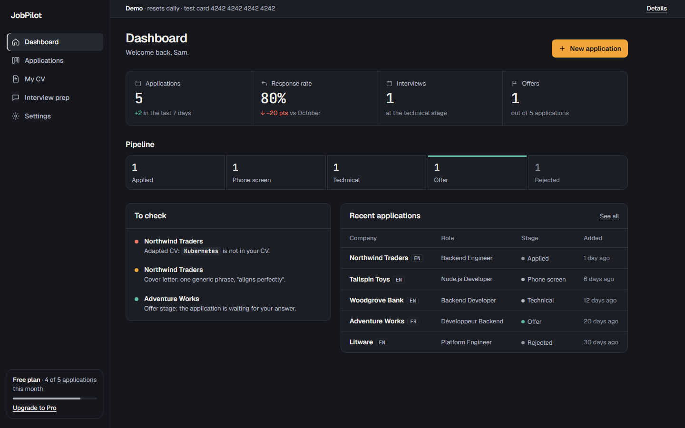
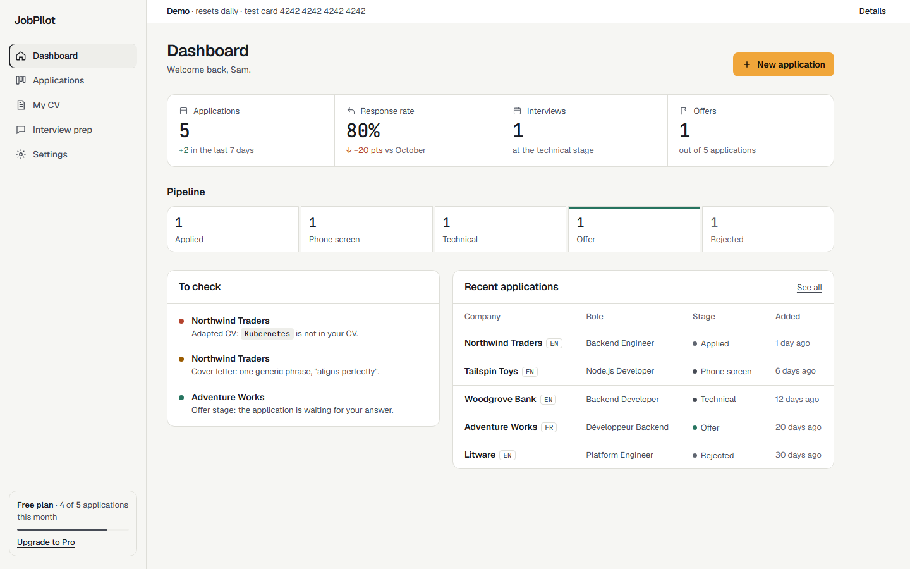
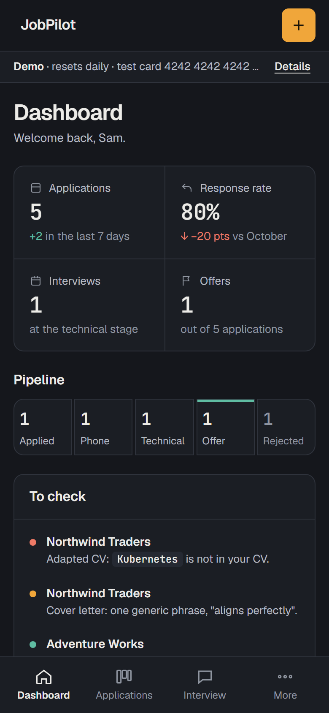
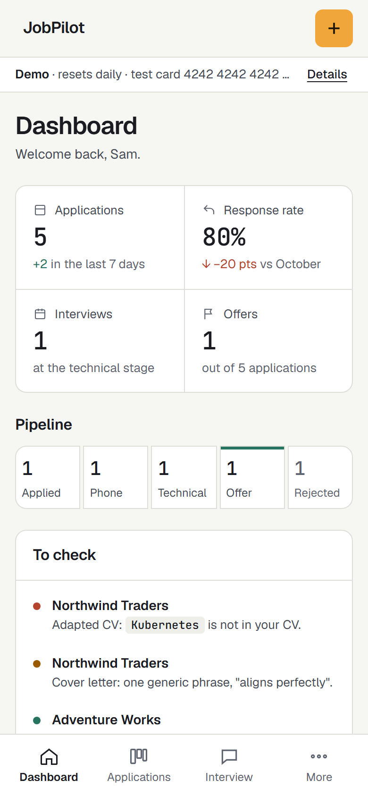

# 6.2 — Visual direction proposal (to validate before any code)

Nothing in the application has changed. This folder holds the proposal:
- the tokens (`tokens.css`);
- a responsive dashboard mockup (`mockup-dashboard.html`: the same file at 1440 and 390 px);
- its rendered images (`node design/proposal/render.mjs`).

The "before" screenshots and the list of problems are in [`../inventory.md`](../inventory.md).

## The idea

JobPilot's promise is to tailor a CV **without inventing anything**. The interface should
look like a reliable tool rather than an "AI" product: quiet, readable, precise with
numbers.

The only element that stands out on the dashboard is what needs checking: claims the CV
does not support, generic phrases, offers waiting for an answer. Everything else steps
back:
- neutral cards with grey icons;
- a single amber button per screen;
- one upgrade call per screen.

## Dashboard mockups

| Desktop 1440, dark | Desktop 1440, light |
|---|---|
|  |  |

| Mobile 390, dark | Mobile 390, light |
|---|---|
|  |  |

Compared with today (`../before/05-dashboard-*`):
- **The figures**: a single panel with four cells instead of four floating cards.
  - Grey icons, sentence-case labels instead of capitals.
  - On mobile, a readable 2 × 2 grid.
  - Changes stay as they are since step 5 ("−20 pts", arrow following the sign).
- **Pipeline**: a segmented bar of the five stages, with the count for each. Offer is
  marked green and Rejected is dimmed.
- **To check** (new, a decision for you):
  - Pulls up the fact-check: claims missing from the CV in the adapted CVs, generic
    phrases in the letters, offers in progress.
  - Everything comes from data that already exists (the checkers in `lib/fact-check`
    and the stage). On the dashboard, it would mean running the checker for each
    application that has an adapted CV or a letter.
- **Recent applications**: a table on desktop, a list on mobile (company, stage, date).
- **Upgrade**: one call only, at the bottom of the sidebar, with the free-plan meter (a
  text link, not amber).
  - The dashboard banner and the "Upgrade — $9/mo" card both go.
  - On mobile, the call moves to "More → Settings".
- **Demo banner**: one line, "Demo · resets daily · test card 4242 4242 4242 4242" with
  "Details" to expand it (on mobile, the line is cut off with an ellipsis).
- **Greeting**: "Welcome back, Sam." on its own line, under the title.

## Typography

- **Geist Sans** (Vercel, free licence) for all text:
  - sizes 13 / 14 / 16 / 20 / 26 px;
  - weights 400, 500 and 600;
  - slightly tight letter-spacing on headings (−0.025em).
- **JetBrains Mono** only for:
  - figures (with `tabular-nums` so they line up);
  - technical badges (`Kubernetes`, the `EN`/`FR` language);
  - code.
- `--font-sans: "JetBrains Mono"` goes away.
- Line length: 80 characters at most in text blocks.
- Inter remains a fallback if Geist does not load.

## Palette

The same names in both themes. Amber is never used for text on white (it fails contrast).

| Token | Dark | Light | Use |
|---|---|---|---|
| `--bg` | `#15171c` | `#f6f6f3` | page background |
| `--surface` | `#1b1e24` | `#ffffff` | panels, tables |
| `--raised` | `#252932` | `#eeeeea` | active item, meter, technical badge |
| `--line` | `#2f333c` | `#deded8` | hairlines (decorative) |
| `--text` | `#ecebe7` | `#1a1c21` | main text |
| `--text-2` | `#b6bac2` | `#464b55` | secondary text |
| `--muted` | `#8f95a0` | `#5f6570` | notes, dates, input borders |
| `--amber` | `#f0a63a` | `#f0a63a` | **primary action only** (fill, text `--on-amber`) |
| `--ok` | `#5fbca2` | `#26745f` | rise, offer, verified |
| `--flag` | `#ee7a66` | `#b4432d` | fall, claim missing from the CV |
| `--focus` | `#9db8f2` | `#2f5fc4` | keyboard focus ring |

**AA contrast measured** (WCAG ratio, 4.5 minimum for text):

| Pair | Dark | Light |
|---|---|---|
| text / bg | 15.0 | 15.7 |
| text-2 / surface | 8.6 | 8.8 |
| muted / surface | 5.6 | 5.9 |
| text on amber | 8.9 | 8.9 |
| ok / surface | 7.3 | 5.6 |
| flag / surface | 6.1 | 5.6 |
| focus / bg | 9.0 | 5.5 |

The hairlines (`--line`, 1.3:1) are decorative. Input fields will use `--muted` as their
border (≥ 3:1, as required for interface components).

## Spacing and shapes

- 4 px grid.
- Gutters: 32 px on desktop, 16 px on mobile. Gap between blocks: 28 px on desktop,
  22 px on mobile.
- Two corner radii:
  - 8 px for buttons and menu items;
  - 12 px for panels.
- No drop shadows: separation comes from hairlines and the `surface` / `raised`
  difference.

## Components (shown in the mockup)

- **Primary button**: amber fill, dark text, 38 px high. One per screen (here: "New
  application").
- **Secondary action**: underlined text ("See all", "Upgrade to Pro", "Details").
- **Navigation**: the active item gets a `--raised` background and a thin bar on the left.
- **Status**: a coloured dot plus a word (never colour alone), in `--text-2`.
- **Fact-check item**: a coloured dot (claim / generic phrase / offer), the company in
  bold, one sentence of explanation, the technology in a mono badge.
- **Focus**: a visible 2 px ring (`--focus`) on every interactive element.
- **Motion**: none on loading; transitions only in response to an action
  (opening/closing). `prefers-reduced-motion` turns them all off.

## Mobile (under 768 px): recommended solution

**A bottom navigation bar** rather than a hamburger:
- 4 entries: Dashboard, Applications, Interview, More (My CV, Settings, plan).
- Why:
  - The three main destinations are used several times per session; a hamburger hides
    them behind an extra tap.
  - The bar is within thumb reach.
  - It takes no width (today the sidebar takes 240 of the 390 px).
- "New application" becomes an amber icon button in the top bar (40 px, `aria-label`).

The other screens, under the same rules (to mock up in 6.5, zone by zone):
- **Kanban**: one column at a time.
  - Stage tabs at the top (with their count) and horizontal swiping between columns.
  - The "list by stage" view was the alternative. I'd go with swiping, which keeps the
    kanban's mental model.
- **Detail panel**: full screen.
  - Tabs that scroll horizontally if needed, never cut off.
  - Actions (Download PDF, Regenerate) wrap onto two lines instead of overflowing.
- **Demo banner**: one short line, expandable.
- **No horizontal scrolling at any width.** The 390 px E2E test will check this on the
  whole demo journey (step 6.4).

## To validate (decisions not taken)

1. **The direction itself**:
   - Geist + JetBrains Mono for the figures;
   - graphite / warm white;
   - amber only for primary actions.
2. **The "To check" block** on the dashboard (new: it runs the checker for each
   application).
3. **Bottom bar** (recommended) or hamburger on mobile.
4. **Mobile kanban**: swiping between columns (recommended) or a list by stage.
5. **Upgrade in one place**: the sidebar meter on desktop, Settings on mobile. The
   dashboard banner and the "Upgrade — $9/mo" card both go.
6. **Home page** (6.3): remove the invented figures (500+, 1,200+, 4.9/5) and the
   "jobpilot.app" domain, as well as the "AI-Powered" pill.
7. The demo's **My CV** (`inventory.md`): show the fictional CV as read-only.
